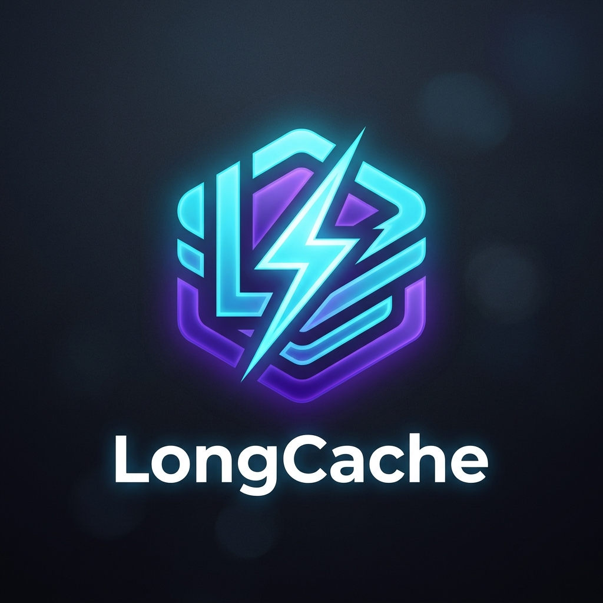

# LongCache ⚡

<p align="center">
  
</p>

<p align="center"><strong>Semantic similarity cache for LLM and RAG pipelines — v0.1.1 beta.</strong></p>

---

## What is LongCache?

> *"What is your refund policy?" may need an LLM call the first time.*
> *A compatible repeated request can reuse the stored response.*

**LongCache** intercepts incoming queries before they reach expensive LLM APIs or vector databases. Unlike traditional string-matching key-value caches, LongCache understands that:

* *"What is your return process?"*
* *"How can I get a refund?"*
* *"Do you accept returns on opened items?"*

can express related intents, but similar wording does not guarantee an interchangeable answer. LongCache uses local embeddings and FAISS to find candidates within the same namespace and request context. Choose a threshold using examples from your application and measure incorrect hits as well as savings.

---

## Key Features

- ⚡ **Zero-API Local Embeddings**: Uses `BAAI/bge-small-en-v1.5` locally on CPU. No OpenAI embedding API costs or network roundtrips required.
- 🚀 **Blazing-Fast Vector Search**: Powered by FAISS (Flat & HNSW) for configurable exact or approximate similarity lookup.
- 🛡️ **Composite Key Isolation**: Prevents cross-model and prompt poisoning by scoping entries by model name, system prompt, temperature, and namespace.
- 🔌 **Pluggable Storage Backends**: SQLite for zero-config persistence, Redis response persistence with a local index, and Memory for testing.
- 🧩 **First-Class Framework Adapters**: Drop-in decorators and wrappers for **LangChain**, **LangGraph**, **LlamaIndex**, **OpenAI**, and **FastAPI**.
- 📊 **CLI & Diagnostics**: Built-in CLI commands to check hit rates, inspect semantic similarities, evict entries, and estimate dollar savings.

---

## Quick Example

```python
from longcache import LongCache

cache = LongCache()

@cache.cached
def my_rag_pipeline(query: str) -> str:
    # Expensive retrieval + frontier model invocation
    return expensive_rag_call(query)

# Call 1: Cache MISS; calls the pipeline
ans1 = my_rag_pipeline("What is your refund policy?")

# Call 2 (exact query): Cache HIT if the entry is still valid
ans2 = my_rag_pipeline("What is your refund policy?")

# Call 3 (paraphrase): Cache HIT if the threshold is met
ans3 = my_rag_pipeline("How do I return a product?")
```

---

## Support in v0.1.1

Python 3.10, 3.11, and 3.12 are tested with SQLite, memory, and synchronous Redis storage. Redis does not synchronize local FAISS indexes across processes. `backend="async_redis"` fails immediately through `LongCache` while the standalone async backend remains experimental.

OpenAI and ASGI caching support a conservative subset of single-turn text requests; unsupported shapes bypass caching. Close cache instances with `cache.close()` or use a context manager. See the [benchmark methodology](benchmarks.md) for repeatable measurements rather than fixed latency or savings promises.

---

## Next Steps

- [Installation Guide](getting-started/installation.md)
- [Quick Start](getting-started/quickstart.md)
- [How It Works](how-it-works/architecture.md)
- [Framework Integrations](integrations/langchain.md)
- [Storage Backends](backends/overview.md)
